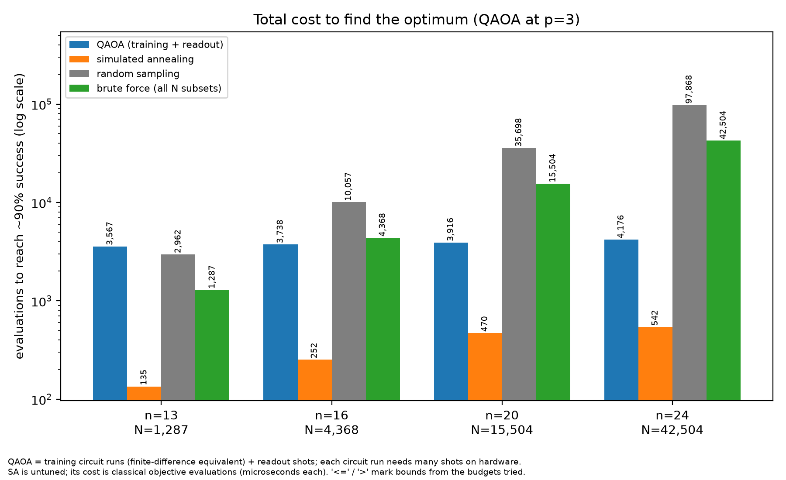

# How We Scaled Heart Disease Screening with Quantum Approximate Optimization Algorithm (QAOA)



## Background

**Objective**

Given a total set of possible measurements, identify which five provide the most value to determine whether a patient has heart disease
Minimize overlapping information while maximizing relevancy

**Datasets**

UCI Heart Disease - Cleveland subset (303 patients, 13 features)

Relevant features: "sex", "cp", "fbs", "restecg", "exang", "slope", "ca", "thal"

## Comparison to Other Methods

**QAOA**

~6000 training cost evaluations at 3 layers to find optimum

**Greedy feed forward**

55 operations to find optimum

**Simulated annealing**

~100-400 to find optimum


No quantum advantage at n = 13

## Quantum Advantage
A larger feature set and more measurements permitted would exponentially increase the subset space

- 20 available features: 15504 subsets
- 30 available features: 142506 subsets

Classical methods would be infeasible here

## Running the repo

Requires Python 3.14+ and [`uv`](https://docs.astral.sh/uv/). All code lives in
`src/`; the scripts import each other by bare module name, so run them from the
repo root.

```bash
uv sync                               # create the venv, install locked deps

uv run python src/qaoa.py             # library QAOA, full 2^n space (p = 1..3)
uv run python src/qaoa_exact.py       # dense exact subspace QAOA + baselines (n = 13)
uv run python src/sparse_qaoa.py      # sparse exact subspace QAOA self-test
uv run python src/qaoa_scaling.py --n 13 16 20 --pmax 5 --seeds 0 1 2 --out results_small.json
uv run python src/plot_results.py --inputs results_small.json results_large.json --outdir figures --depths 3 5 --cost-depth 3
uv run python src/lamsweep.py         # argmin subset vs top-5-MI baseline
uv run python src/evaluate.py         # downstream AUC across λ (30 splits)
uv run python src/evaluate_extended.py --n 13 20 25 --lam 0.75 1.5 3.0
uv run python src/test.py             # fetch_ucirepo connectivity check
```

`qaoa_scaling.py` writes `results_*.json`; `plot_results.py` turns those into
the three PNGs under `figures/`.

## Repository layout

`src/` — all code:

| File | Purpose |
|---|---|
| `data.py` | `load_heart_disease()`: fetch/clean UCI Heart Disease (id 45), compute relevance `r` (mutual information) and redundancy `c` (`|correlation|`) |
| `qaoa.py` | Library `qiskit_algorithms.QAOA` over the full 2^n space (penalty forces exactly `k`); QUBO → Ising → `SparsePauliOp`, brute-force reference |
| `qaoa_exact.py` | Dense exact QAOA in the weight-k subspace (NumPy), plus greedy and simulated-annealing baselines; n = 13 only |
| `sparse_qaoa.py` | Sparse exact subspace QAOA (Johnson-graph XY mixer, analytic gradients); scales to n ≈ 24–26 |
| `qaoa_scaling.py` | Scaling-study driver: sparse QAOA vs baselines across seeds and n; writes the JSON |
| `plot_results.py` | Renders `fig_depth.png`, `fig_scaling.png`, `fig_cost.png` from the JSON |
| `data_expanded.py` | Expanded candidate pool (one-hot categorical levels) for the scaling study; nested n = 13..30 instances |
| `data_extended.py` | Earlier "Option A" expanded-pool variant (superseded by `data_expanded.py`) |
| `evaluate.py` | Downstream logistic-regression AUC across λ on the base 13 features (30 splits) |
| `evaluate_extended.py` | Same protocol over the expanded pool |
| `lamsweep.py` | λ sweep: argmin subset vs top-5-MI baseline |
| `test.py` | One-line `fetch_ucirepo` connectivity check |
| `qiskit_gt/` | Package stub; `qiskit_gt:main` is the `qiskit-gt` console entry point |

Root:

| Path | Purpose |
|---|---|
| `PROMPT.md` | The assignment (Prompt B: Heart Disease Readings) |
| `pyproject.toml` / `uv.lock` | Project metadata, dependencies, and lockfile |
| `results_small.json` / `results_large.json` | Scaling-study outputs consumed by `plot_results.py` |
| `figures/` | Generated PNGs |
